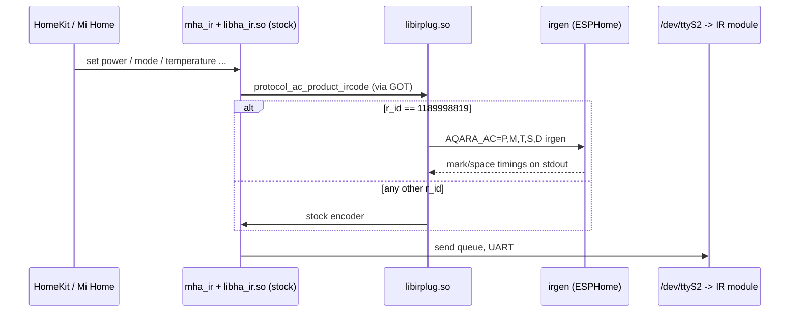

# aqara-ir-esphome

Use any [ESPHome `climate_ir`](https://esphome.io/components/climate/climate_ir.html) encoder on the
**Aqara Air Conditioning Companion P3 (KTBL12LM)**, while keeping the stock app, HomeKit and
Mi Home control.

The P3 only knows the IR code sets in its own library and Aqara's cloud. If your air conditioner's
remote is not there (this project started with a Gree **YAP0F** remote, supported by
[ryanh7/esphome-custom-components](https://github.com/ryanh7/esphome-custom-components)), the
companion cannot drive it. ESPHome already has encoders for dozens of brands, so this project lets
the P3 hand the AC state to an ESPHome build that runs on the P3 itself.

Everything the stock firmware does (HomeKit, Mi Home, automations, power metering, the IR queue
and the IR module) stays as it is. Only the step "AC state -> IR timings" is replaced, and only
when you select it.

## Requirements

- Aqara AC Companion P3, firmware **4.5.20_0033.0652**, in Mi Home mode.
- Telnet access as `admin` (empty password), e.g. via the community firmware from
  [niceboygithub/AqaraM1SM2fw](https://github.com/niceboygithub/AqaraM1SM2fw) or the debug mode.
- A Linux x86_64 PC with Python 3.13, `fakeroot`, `squashfs-tools` and `ncat` for building.

`irplug.c` contains offsets for one specific `/lib/libha_ir.so` (md5 `2b73769db0b7569344ea5ca58fd925cc`).
On other firmware versions they must be recomputed, see [Porting](#porting-to-another-firmware).

## How it works



- **`irgen`** is a normal ESPHome project built for ESPHome's `host` platform and cross-compiled to a
  static MIPS32r2 binary. Its YAML holds one `climate_ir` entity (your AC model), plus two small
  components from this repo: `aqara_ir` turns `$AQARA_AC` into a `ClimateCall`, and a replacement
  `remote_transmitter` prints the generated timings instead of driving a GPIO.
- **`libirplug.so`** is loaded by `mha_ir -r` instead of `/lib/libha_ir.so` and depends on it, so the
  stock code is all there. Its `ha_ir_open` points libha_ir's GOT slot for
  `protocol_ac_product_ircode` at its own function, then calls the stock `ha_ir_open`.
  (The P3's uClibc 0.9.33 ignores `LD_PRELOAD`, and its MIPS loader binds a library's own symbols
  to itself, so plain symbol interposition does not work.)
- The ESPHome encoder is used when the stored remote id `persist.app.ir.r_id` is **1189998819**
  (0118 999 881 9, the IT Crowd emergency number, cut to fit a 32-bit int). Any other id keeps the
  stock behaviour, so switching back is one `setprop`.
- **Firmware patch** (`src/firmware/rootfs.patch`): `rcS` runs `/data/scripts/post_init.sh` again, and
  `fw_manager.sh` / `app_monitor.sh` start `mha_ir` with `libirplug.so` when it exists. Without the
  patch everything works too, but only until `mha_ir` restarts or the P3 reboots.

`AQARA_AC` fields: P power (1 = off), M mode (0 cool, 1 heat, 2 auto, 3 fan, 4 dry),
T target temperature in C, S fan (0 auto, 1 low, 2 medium, 3 high), D swing (0 = on).

## Install

All device commands run in a telnet session on the P3.

### 1. Build

```sh
git clone https://github.com/leohearts/aqara-ir-esphome && cd aqara-ir-esphome
python3.13 -m venv venv && venv/bin/pip install esphome ziglang
export PATH=$PWD/venv/bin:$PATH
# pick your AC: edit src/irgen/irgen.yaml (see "Choose the AC model")
./src/irgen/build.sh                      # -> src/irgen/.esphome/build/irgen/mips/irgen
# copy /lib/libha_ir.so from the P3 to src/irplug/ first
./src/irplug/build.sh                     # -> src/irplug/libirplug.so
```

### 2. Copy to the P3

```sh
# on the P3
mkdir -p /data/esphome-ir && nc -l -p 9092 > /data/esphome-ir/irgen
# on the PC
ncat --send-only <p3-ip> 9092 < src/irgen/.esphome/build/irgen/mips/irgen
# repeat for libirplug.so, then on the P3:
chmod +x /data/esphome-ir/irgen
ESPHOME_PREFDIR=/tmp AQARA_AC=0,1,26,0,0 /data/esphome-ir/irgen   # prints timings
```

`src/irgen/build.sh upload` does the irgen copy for you (set `DEVICE=<p3-ip>`).

### 3. Select the ESPHome encoder

```sh
getprop persist.app.ir.r_id                          # note the old value to switch back later
setprop persist.app.ir.r_id 3131383939393838313900   # "1189998819": hex string + 00
killall mha_ir; mha_ir -r /data/esphome-ir/libirplug.so >/dev/null 2>&1 &
```

Now control the AC from the app. To check that a frame went out, compare
`grep '^2:' /proc/tty/driver/serial` (the IR module's UART, `tx:` counter) before and after.

### 4. Make it survive reboots (firmware patch)

Base image: niceboygithub `modified/P3/4.5.20_0033.0652/rootfs_4.5.20_0033.0652_modified.bin`
(md5 `a209d9b3d253b75afa87d01437230911`).

```sh
tail -c +17 rootfs_4.5.20_0033.0652_modified.bin > mod.sqfs
fakeroot -s fr.state unsquashfs -d root mod.sqfs            # fakeroot keeps the /dev nodes
(cd root && patch -p1 < ../src/firmware/rootfs.patch)
fakeroot -i fr.state mksquashfs root new.sqfs -comp xz -b 131072 -noappend
python3 src/firmware/mkimg.py new.sqfs rootfs_ir.bin        # Realtek r6cr header + checksum
```

The result should have md5 `1bae852b5cd57b2388507fafefa60ab0`. The image format only has a 16-bit
checksum, no signature, and the bootloader reports `root_sum_check: off`.

Make sure `/data/scripts/post_init.sh` exists, is executable and starts the stock services, because
with the patch `rcS` runs it **instead of** `fw_manager.sh -r`:

```sh
printf '#!/bin/sh\n\nfw_manager.sh -r\nfw_manager.sh -t -k\n' > /data/scripts/post_init.sh
chmod +x /data/scripts/post_init.sh
```

Then flash from the P3 (copy the image to `/tmp`, which is RAM; `/data` is too small):

```sh
fw_update /tmp/rootfs_ir.bin    # ends with "crc ok" / "Success"
boot_ctrl show                  # the inactive rootfs slot now has the new size and is selected
reboot
```

The P3 has two kernel/rootfs slots; `fw_update` writes the inactive one, the previous system stays in
the other slot. An official OTA update replaces the patch.

**Flashing can brick the device.** Only flash an image whose md5 matches, and keep telnet working.

## Choose the AC model

Edit the `climate:` entry in `src/irgen/irgen.yaml`. Keep `id: ac` and `transmitter_id: ir_out`:

```yaml
climate:
  - platform: coolix          # any ESPHome climate_ir platform, or an external one like gree_ext
    id: ac
    name: AC
    transmitter_id: ir_out
```

Rebuild and copy `irgen`. No restart is needed: `mha_ir` starts `irgen` for every IR command.

## Switch back

```sh
setprop persist.app.ir.r_id <old value>    # stock encoder
rm /data/esphome-ir/libirplug.so            # or drop the plugin entirely
killall mha_ir                              # app_monitor.sh restarts it
```

## Porting to another firmware

`irplug.c` needs three numbers from that firmware's `/lib/libha_ir.so`:

- `OFF_SYNC`, `OFF_OPEN`: `st_value` of `protocol_ac_sync` and `ha_ir_open` in `.dynsym`.
- `OFF_GOT_PRODUCT`: `DT_PLTGOT + 4 * (DT_MIPS_LOCAL_GOTNO + symidx - DT_MIPS_GOTSYM)`, where `symidx`
  is the `.dynsym` index of `protocol_ac_product_ircode` (it must be `>= DT_MIPS_GOTSYM`).

Also check that `protocol_ac_product_ircode` still takes the AC state as its 4th argument with the
same layout (power +0, mode +4, temperature +9, fan +12, swing +16).

## Notes

- Do not overwrite `libirplug.so` while `mha_ir` has it loaded (SIGBUS). Stop `mha_ir` first.
- Inside `mha_ir`, `pclose()` does not return 0 even when `irgen` succeeds (likely because SIGCHLD
  is ignored; not verified), so the plugin judges by the parsed output.
- `persist.app.ir.*` properties are hex-encoded strings with a trailing `00`.
- Local IPC is `/tmp/miio_agent.socket` (SOCK_SEQPACKET): bind with `{"method":"bind","address":N}`;
  `mha_ir` is address 512 and accepts e.g.
  `{"id":1,"_to":512,"method":"local.ir_write","params":[{"did":"<did>","prop":"on_off_status","value":"1"}]}`.

## Credits

- [ESPHome](https://esphome.io) and its `climate_ir` platforms.
- [ryanh7/esphome-custom-components](https://github.com/ryanh7/esphome-custom-components) for `gree_ext` (YAP0F).
- [niceboygithub/AqaraM1SM2fw](https://github.com/niceboygithub/AqaraM1SM2fw) for the P3 firmware images and tools.

## License

MIT, see [LICENSE](LICENSE). Not affiliated with Aqara, Lumi or Xiaomi.
